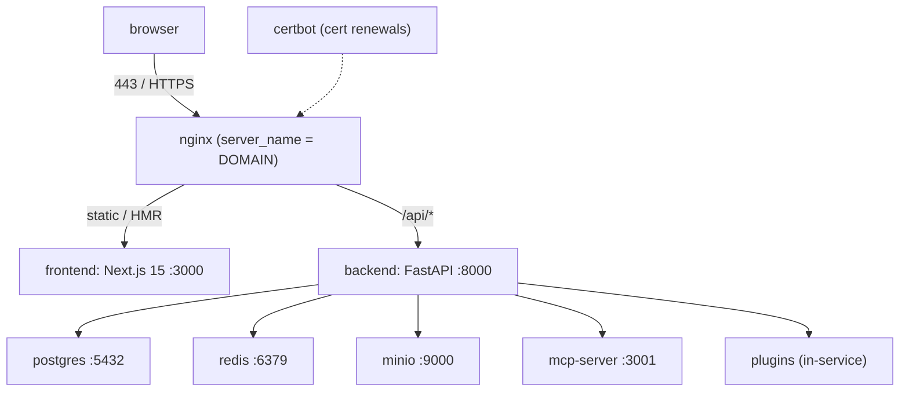

# RedWire admin guide

Everything an operator needs to deploy, configure, back up, upgrade, and
keep RedWire running. For the environment-variable reference itself, see
[`.env.example`](../.env.example) at the repo root — every var is
documented inline there.

- [Architecture at a glance](#architecture-at-a-glance)
- [First-time install](#first-time-install)
- [TLS and certificates](#tls-and-certificates)
- [Running behind an existing reverse proxy](#running-behind-an-existing-reverse-proxy)
- [Backups](#backups)
- [Restoring from backup](#restoring-from-backup)
- [Upgrades](#upgrades)
- [Rotating credentials and keys](#rotating-credentials-and-keys)
- [Optional integrations](#optional-integrations)
- [Plugins](#plugins)
- [Troubleshooting](#troubleshooting)

---

## Architecture at a glance

Seven services on one Compose network. Only nginx exposes ports to the
host in prod — everything else is internal to the Docker network.



**Ports exposed to the host (prod, `docker-compose.yml`):**

| Host port | Service | Purpose |
|---|---|---|
| 80 | nginx | ACME HTTP-01 + 301 redirect to HTTPS |
| 443 | nginx | The one public port. TLS terminated here. |

Everything else (Postgres, Redis, MinIO, MCP, backend, frontend) is
network-internal and unreachable from outside the host. This is by
design — do not add `ports:` mappings for those services in prod.

**Ports exposed in dev (`docker-compose.dev.yml`) for local hacking:**

| Host port | Service | Purpose |
|---|---|---|
| 5432 | postgres | Direct DB access (`psql`, DBeaver) |
| 6379 | redis | Direct Redis access |
| 8000 | backend | Bypass nginx during backend work |
| 9000 / 9001 | minio / minio-console | Bucket admin UI |
| 3001 | mcp-server | MCP SSE endpoint |
| 8080 / 8443 | nginx (dev) | Test the full nginx flow locally |

---

## First-time install

Prerequisites: Docker + Docker Compose, `git`, Python 3, `openssl` (all
present on any modern Linux). ~2 GB RAM minimum; 4 GB recommended.

```bash
git clone <repository-url>
cd redwire
./scripts/deploy_server.sh
```

The script:

1. **Prompts** for `DOMAIN_NAME`, admin username, admin email, and admin
   password (blank → random hex).
2. **Generates** cryptographically-strong random values for every secret
   in `.env`:
   - `POSTGRES_PASSWORD`, `REDIS_PASSWORD`, `MINIO_ROOT_PASSWORD`, `JWT_SECRET` — each 32 random bytes as hex.
   - `VAULT_ENCRYPTION_KEY`, `TOTP_ENCRYPTION_KEY` — real **Fernet** keys (44-char base64). Hex values will NOT work for these.
3. **Writes** `.env` and `credentials_DO_NOT_SHARE.txt` at mode `0600`.
4. **Builds and starts** every service via `docker-compose.yml`.
5. **Runs Alembic migrations** (via `backend/migrate.py` — advances every
   plugin branch too, not just core).
6. **Optionally bootstraps** a Let's Encrypt certificate via Certbot.
   Skip it for on-prem / internal-CA setups; the temporary self-signed
   cert continues to work.

When the script exits, the platform is reachable at `https://<your-domain>`
and the admin credentials are in `credentials_DO_NOT_SHARE.txt`. **Move
that file somewhere safe and delete the copy on the server.**

### Fresh install from a git clone vs. an offline zip

The deploy script auto-detects which flow to use:

- **`redwire_migration_package.zip` present** — extracts the zip (upgrade
  path from an older install or export from `scripts/export_system.ps1`).
- **No zip present** — uses the in-place source (git clone case). Skips
  the wipe-and-extract step so it doesn't delete the files you just
  cloned.

Offline installs (air-gapped hosts): generate `redwire_images.tar` on a
connected machine with `pwsh scripts/export_system.ps1 -IncludeImages`,
ship both the zip and tar to the target, run `./deploy_server.sh --offline`.

---

## TLS and certificates

Three supported topologies. Pick the one that matches your deploy.

### 1. Let's Encrypt (public internet, RedWire is the only proxy)

The default when you say yes to the Certbot prompt in `deploy_server.sh`.
The script generates a self-signed placeholder cert so nginx boots, then
uses the webroot challenge on port 80 to swap in a real cert.

Renewal is automatic — the `certbot` container runs `certbot renew`
every 12 hours. As long as ports 80 and 443 stay open in your firewall,
you don't have to think about it.

### 2. Bring your own cert (internal CA, wildcard, corporate PKI)

Skip the Certbot prompt. Drop your fullchain + private key into:

```
nginx/certbot/conf/live/${DOMAIN_NAME}/fullchain.pem
nginx/certbot/conf/live/${DOMAIN_NAME}/privkey.pem
```

Then `docker compose restart nginx`. Nothing
else changes; the nginx config already reads from that path.

### 3. Behind another reverse proxy (chained nginx / traefik / CDN)

If TLS is terminated **upstream** (in front of RedWire's nginx), then
RedWire's nginx doesn't need to do TLS at all. See the next section for
the full drill.

---

## Running behind an existing reverse proxy

Common in enterprise deploys — RedWire sits behind an outer load
balancer / WAF / corporate proxy that owns the public cert.

### Things that must be right

1. **The outer proxy must terminate TLS and forward plain HTTP** to
   RedWire's nginx. Modify RedWire's `nginx/conf.d/default.conf.template`
   so the `listen 443 ssl;` block becomes `listen 80;` (and drop the
   `ssl_certificate` / `ssl_certificate_key` lines), then point the outer
   proxy at RedWire's port 80 (or whatever port you map that to). If the
   outer proxy forwards plain HTTP to RedWire's HTTPS listener, you get
   `400 Bad Request — The plain HTTP request was sent to HTTPS port`.

2. **The outer proxy must forward these headers accurately**:

   ```
   proxy_set_header Host              $http_host;      # keep the port
   proxy_set_header X-Real-IP         $remote_addr;    # for rate limiting
   proxy_set_header X-Forwarded-For   $remote_addr;    # do NOT append — see below
   proxy_set_header X-Forwarded-Proto https;           # so cookies get Secure flag
   proxy_set_header Origin            $http_origin;    # preserve the port
   ```

   `$host` (without port) breaks CORS behind non-default ports.
   `proxy_add_x_forwarded_for` (which appends the client's own header)
   opens X-Forwarded-For spoofing that lets a caller escape the rate
   limiter (GHSA-xg53-8wgq-w9cw). Use `$remote_addr` alone.

3. **Set `CORS_ORIGINS`** to exactly what the browser sends in `Origin`.
   That's the URL bar's origin — scheme + host + port, no path. If the
   URL bar shows `https://redwire.example.com` (default 443), the port
   is omitted in `Origin` per the CORS spec.

4. **Set `NEXT_PUBLIC_API_URL=/api`** and rebuild the frontend. This
   avoids the class of "the API URL doesn't include the port the users
   are actually visiting" problems entirely — the client uses the
   current page's origin, which is always right.

### If you can't touch the outer proxy configs

Add EVERY origin the browser might send to `CORS_ORIGINS`, port-having
and port-less:

```
CORS_ORIGINS=https://redwire.example.com,https://redwire.example.com:8443
```

---

## Backups

Four things need backup. In priority order:

| # | What | Where | If lost |
|---|---|---|---|
| 1 | `VAULT_ENCRYPTION_KEY` + `TOTP_ENCRYPTION_KEY` | `.env` | Every vault credential + every user's TOTP secret becomes unrecoverable. There is no admin override for lost-key decrypt. |
| 2 | Postgres data | `postgres_data` Docker volume | All engagements, findings, users, audit trail, settings |
| 3 | MinIO evidence bucket | `minio_data` Docker volume | Uploaded evidence files, generated reports, plugin assets |
| 4 | `.env` (rest of it) | Install directory | Config only — you can regenerate on install, but you'll lose custom values |

`backup.sh` covers 2 and 3 (plus `backend/uploads`). **The keys (1) are
not in its backups by default**: store `.env` — or at least the two keys —
in your team's secret store, away from the database backups. A backup that
holds both the database and the keys hands every vault secret to whoever
gets a copy of it.

### Automated: `backup.sh`

`deploy_server.sh` installs `/etc/cron.d/redwire-backup` (rewritten on
every deploy) with two jobs, run from the install directory:

- **Daily 03:30 — backup.** Writes `backups/<timestamp>/` (owner-only
  permissions): `db.dump` (Postgres, custom format), `minio.tar.gz`,
  `uploads.tar.gz`, `alembic_version.txt` and `keys.sha256` (fingerprints
  of the two encryption keys — not the keys). MinIO is stopped for the
  seconds its volume takes to archive, so the copy is consistent; uploads
  made in that window fail and can be retried. A run writes into
  `<timestamp>.partial/` and renames it only once every part is written and
  reads back, so a failed run leaves nothing behind and never pushes a good
  backup out of retention. The newest 7 are kept.
- **Sunday 04:30 — restore drill** (`backup.sh --verify`). Restores the
  newest backup's database into a scratch database, checks its migration
  revision, decrypts a stored vault value and a 2FA secret with the keys in
  use now, tests the archives, compares the key fingerprints, and drops the
  scratch database. Failures are logged as `verify FAIL` lines.

Both log to `backups/backup.log`. Every deploy also writes a database-only
`backups/<timestamp>-predeploy/` snapshot before migrating (the newest 5
are kept) — that's the `--rollback` point.

```bash
./backup.sh                      # full backup now
./backup.sh --db-only            # database only
./backup.sh --verify             # restore drill on the newest full backup
./backup.sh --verify backups/<timestamp>
```

Settings, as environment variables or the same names in `.env` (`.env`
survives deploys and needs no cron edits):

| Setting | Default | |
|---|---|---|
| `BACKUP_REMOTE` | — | rsync target, e.g. `user@host:/srv/redwire-backups`. **Set this**: backups on the server's own disk don't survive losing the server. |
| `BACKUP_KEEP` | `7` | full backups kept |
| `BACKUP_DIR` | `./backups` | where backups go |
| `BACKUP_INCLUDE_ENV` | `0` | `1` also copies `.env` into each backup as `env`. Only if those backups are themselves kept as secrets. |

---

## Restoring from backup

You need the encryption keys the backup was taken with (from your secret
store), else vault items and 2FA secrets come back as unreadable
ciphertext. `--restore-db` compares them with the backup's `keys.sha256`
and refuses on a mismatch (`RESTORE_IGNORE_KEYS=1` overrides).

```bash
# 1. .env with the original VAULT_ENCRYPTION_KEY / TOTP_ENCRYPTION_KEY
#    (and JWT_SECRET, or everyone signs in again)
chmod 600 .env

# 2. The database: stops the app containers, recreates the database empty,
#    restores the dump into it.
./backup.sh --restore-db backups/<timestamp>/db.dump

# 3. MinIO objects and uploads (MinIO stopped while its data is replaced)
docker compose stop minio
docker run --rm --volumes-from redwire-minio -v "$PWD/backups/<timestamp>":/in alpine \
    sh -c 'rm -rf /data/* && tar xzf /in/minio.tar.gz -C /data'
tar xzf backups/<timestamp>/uploads.tar.gz -C backend/

# 4. Start everything (images of the backup's version or newer — newer
#    ones migrate the database forward on start)
docker compose up -d --wait
```

Don't `pg_restore --clean` over the live database instead: tables the dump
doesn't know survive it, and the backend then crash-loops re-running the
migrations that created them.

Verify by logging in as the original admin and opening a vault item whose
plaintext you know — or run `./backup.sh --verify` on the backup first.

---

## Upgrades

The canonical upgrade path is a re-run of `deploy_server.sh` from a
newer git clone (or with a newer `redwire_migration_package.zip` in
place):

```bash
cd /path/to/redwire
git pull
./scripts/deploy_server.sh
```

The script:

- Preserves your existing `.env` (does NOT prompt again).
- Adds any newly-required secret keys if they're missing (currently
  `VAULT_ENCRYPTION_KEY` / `TOTP_ENCRYPTION_KEY` — this is what makes
  upgrades from pre-1.2 installs safe; if it generates new keys it also
  runs `rotate_encryption_keys.py` to migrate existing data onto them).
- Rebuilds the images.
- Runs `python migrate.py upgrade heads` (all Alembic branches — core +
  every plugin).
- Restarts the stack and waits until the backend, frontend and MCP
  server report healthy (`docker compose up -d --wait`); nginx is
  recreated so changes to its config apply. If a service doesn't come
  up, the script prints its state and logs and stops.

Downtime during a normal upgrade is ~30–60 seconds while the containers
restart. Postgres data + MinIO buckets are volume-mounted so they
survive the container swap.

### Rolling back

Each deploy that starts from a healthy install records a rollback point
before it upgrades anything: the images that were running, tagged
`:previous`, and the pre-deploy database snapshot (`backups/rollback/`).
To go back to it:

```bash
./deploy_server.sh --rollback        # asks first; --yes skips the prompt
```

It dumps the current database to `backups/<stamp>-prerollback/` (so
nothing written since the deploy is lost for good), stops the app
containers, recreates the database from the snapshot, puts the
`:previous` images back on `:latest` and starts them, waiting until they
report healthy. The source tree on disk stays the new release; deploy a
package again to move forward. Uploaded files in MinIO and
`backend/uploads` are left as they are.

Don't roll back by checking out an older tag and rebuilding: the older
backend runs its migrations at start, finds a database revision newer
than any it knows, and restarts in a loop. The images and the database
have to go back together, which is what `--rollback` does.

To restore any other dump (a daily backup, a pre-deploy snapshot):

```bash
./backup.sh --restore-db backups/<stamp>/db.dump
docker compose up -d --wait
```

Start it with images of the dump's version or newer; newer ones migrate
it forward. `--restore-db` recreates the database empty first. Restoring
with `pg_restore --clean` over the live database instead leaves the
newer release's tables in place, and the backend then crash-loops
re-running the migrations that created them.

---

## Rotating credentials and keys

### Admin password

Log in as the admin and change it from Settings → Profile. No compose
work needed. To do it from the DB shell (lost admin password scenario):

```bash
docker exec -it redwire-backend python -c "
from auth.password import get_password_hash
print(get_password_hash('newpassword'))
"
docker exec -it redwire-db psql -U redwire -d redwire -c \
    "UPDATE users SET hashed_password='<hash from above>' WHERE username='admin';"
```

### Postgres / Redis / MinIO passwords

These are stored in `.env` and read by both Compose (to init the
service) and the backend (to connect). Change one at a time:

```bash
# Example: rotate REDIS_PASSWORD
sed -i 's/^REDIS_PASSWORD=.*/REDIS_PASSWORD=<new-value>/' .env
docker compose up -d --force-recreate redis backend
```

Both services need to restart together — old backend + new Redis (or
vice versa) means the backend can't authenticate.

### `JWT_SECRET`

Rotating this invalidates every active session — every user gets
logged out on the next request. Do it during a maintenance window.

```bash
sed -i "s/^JWT_SECRET=.*/JWT_SECRET=$(openssl rand -hex 32)/" .env
docker compose up -d backend    # recreate: `restart` keeps the old environment
```

### `VAULT_ENCRYPTION_KEY` / `TOTP_ENCRYPTION_KEY`

**Do not just change these.** The vault, spray results, auth settings
(LDAP/SMTP/SAML secrets), plugin settings and TOTP seeds are encrypted
under the current keys. Changing a key without re-encrypting the data
leaves that data unreadable, exactly like losing the key.

`rotate_encryption_keys.py` re-encrypts everything. It reads the
**current** keys from `OLD_VAULT_ENCRYPTION_KEY` / `OLD_TOTP_ENCRYPTION_KEY`
and the **new** keys from `VAULT_ENCRYPTION_KEY` / `TOTP_ENCRYPTION_KEY`, so
pass all four to a one-off container. Stop the backend first: while it runs
it keeps writing under the old key, and those rows would be unreadable
afterwards.

```bash
# 1. Back up first (database, MinIO and .env).
./backup.sh

# 2. Generate new keys and note the current ones.
python3 scripts/generate_encryption_keys.py
grep -E '^(VAULT|TOTP)_ENCRYPTION_KEY=' .env

# 3. Stop the backend, then preview the rotation.
docker compose stop backend
docker compose run --rm \
  -e OLD_VAULT_ENCRYPTION_KEY=<current vault key> \
  -e OLD_TOTP_ENCRYPTION_KEY=<current totp key> \
  -e VAULT_ENCRYPTION_KEY=<new vault key> \
  -e TOTP_ENCRYPTION_KEY=<new totp key> \
  backend python3 rotate_encryption_keys.py --dry-run

# 4. Run the same command without --dry-run.

# 5. Put the NEW keys in .env, then recreate the backend. `restart` would
#    keep the old environment.
docker compose up -d backend

# 6. Confirm everything opens under the new keys (read only).
docker compose exec backend python3 rotate_encryption_keys.py --verify
```

The preview reports how many values it would re-key. If it reports any
`UNDECRYPTABLE` values, the "current" key you passed is not the one the
data was written with. A real run refuses to write anything in that case,
so check the key and try again. Pass `--allow-undecryptable` only if you
know those values are already lost. The script is safe to re-run if it's
interrupted: values already under the new key are skipped.

Rotate both keys in one run, or pass the same value as old and new for the
key you're keeping.

`--verify` decrypts every encrypted value and vault file with the keys the
backend is running with and changes nothing. It prints `OK` and exits 0, or
lists what doesn't open and exits 1. It's also a quick check after restoring
a backup onto a server whose `.env` you've rebuilt.

---

## Optional integrations

RedWire supports three optional identity / notification providers.
**None are configured via env vars** — all three live in the
`auth_settings` DB table and are configured from the admin UI. This
keeps secrets out of `.env` and lets you rotate them without restarts.

### LDAP (Active Directory / OpenLDAP)

Admin → Auth Settings → LDAP:

- Enable the integration.
- Enter `server_url` — `ldap://` for plaintext or `ldap://` with
  StartTLS mode, or `ldaps://` for direct TLS from connect.
- Pick TLS mode: `LDAPS`, `StartTLS`, or `None` (not recommended —
  cleartext bind).
- Toggle "Verify certificate" off ONLY for self-signed servers where you
  can't ship a CA cert (marked "insecure" in the UI).
- Configure `bind_dn`, `bind_password`, `search_base`, and the attribute
  mapping (`username_attribute`, `email_attribute`, etc.).
- Test the connection before saving.

RedWire uses JIT (just-in-time) provisioning — LDAP users show up in
the users table on first successful login.

### SAML 2.0 SSO

Admin → Auth Settings → SAML:

- Provide the IdP metadata: `idp_entity_id`, `idp_sso_url`,
  `idp_slo_url`, `idp_x509_cert`.
- Set your SP entity ID (usually your domain).
- Enable "Require signed messages" if your IdP signs.

Also set `BACKEND_URL` and `FRONTEND_URL` in `.env` — they're used to
construct the AssertionConsumerService callback URL. Get those wrong
and SAML validation fails with cryptic errors.

### SMTP (password reset emails, notification digests)

Admin → Auth Settings → SMTP:

- Standard SMTP fields (host, port, username, password, from address).
- Enable STARTTLS if your server supports it (most do on port 587).
- Test with the "send test email" button before enabling in production.

---

## External MCP clients

The MCP server (`mcp-server`, port 3001 inside the Docker network) is what
the in-app AI chat uses. **Production doesn't expose it**: it has no
published port and nginx has no route to it, so an external client such
as Claude Desktop can't reach it on a default install. (In development
`docker-compose.dev.yml` publishes it on `127.0.0.1:3001`.)

To allow external clients, add these to the HTTPS `server` block of
`nginx/conf.d/default.conf.template` and restart nginx. The SSE stream
tells the client to POST back to `/messages/`, so both paths are needed:

```nginx
location = /mcp/sse {
    set $mcp_url http://mcp-server:3001;
    rewrite ^/mcp/sse$ /sse break;
    proxy_pass $mcp_url;
    proxy_http_version 1.1;
    proxy_set_header Host $http_host;
    proxy_set_header Authorization $http_authorization;
    proxy_buffering off;            # SSE
    proxy_read_timeout 1h;
}
location ^~ /messages/ {
    set $mcp_url http://mcp-server:3001;
    proxy_pass $mcp_url;
    proxy_http_version 1.1;
    proxy_set_header Host $http_host;
}
```

Clients connect to `https://<your-domain>/mcp/sse` with
`Authorization: Bearer <token>` (a RedWire API token is best); the session
has exactly that token's permissions. Routing it publicly adds an
internet-facing endpoint, so only do this if you need it.

---

## Plugins

RedWire ships two example plugins (`servicenow_cmdb`, `shodan_enricher`)
in `backend/plugins/`. Third-party or private plugins drop in the same
directory and are discovered on backend startup.

Each plugin can register:

- Backend routes (mounted under `/plugins/<slug>` with `Depends(get_current_user)`).
- Event handlers (subscribe to CRUD events + lifecycle hooks like
  `auth.login.success`, `report.generated`).
- Sidebar nav items (with an icon and per-permission RBAC gate).
- Dashboard widgets.
- Admin settings (encrypted at rest when `type: secret`).
- Alembic migrations on their own branch (`plugin:<slug>`).
- Frontend React pages under `frontend/`.
- Extension slots — plugin components rendered inside core pages via
  `<PluginSlot slot="...">`.

For the full plugin author reference, see
[`backend/plugins/README.md`](../backend/plugins/README.md).

**Operator workflow:**

- **Enable / disable a plugin at runtime:** Admin → Plugins → toggle.
  Routes go 503, event listeners silence, sidebar item disappears. No
  restart needed.
- **Configure plugin settings:** Admin → Plugins → click the plugin.
- **Install a new plugin:** drop the plugin dir into `backend/plugins/<slug>/`,
  then rebuild. The production images bake the code in (nothing is
  bind-mounted), so a restart alone doesn't see the new directory:
  ```
  docker compose build backend frontend
  docker compose up -d backend frontend
  ```
  (The frontend rebuild is what picks up a plugin's React pages; skip it
  if the plugin has none.) In development (`docker-compose.dev.yml`) the
  backend is bind-mounted, so `docker compose -f docker-compose.dev.yml
  restart backend` is enough there.

  `scripts/deploy_server.sh` replaces everything in `backend/` (except
  `uploads/`, `evidence/` and `.env*`) with the deploy package, so a
  plugin added on the server by hand is removed by the next deploy. Put
  it in the package (`backend/plugins/` of the release you deploy).
- **Uninstall:** remove `backend/plugins/<slug>/` (and from the deploy
  package), then rebuild as above. Any data the plugin persisted stays
  until you drop its tables (they're on their own Alembic branch — see
  `backend/migrate.py` for the multi-head handling).

---

## Troubleshooting

### 502 Bad Gateway from nginx

The service nginx tries to proxy to isn't responding. Usually:

- **Frontend or backend container down.** `docker compose ps` — anything
  in `Exited` state? `docker logs redwire-<service>` for why.
- **Container starting up.** Give it 30–60 seconds after
  `docker compose up`. The backend runs migrations before it accepts
  connections.
- **Nginx can't resolve the upstream hostname.** Rare, happens after a
  compose down/up when nginx cached a stale DNS. `docker compose restart nginx`.

### 400 Bad Request when going through an external proxy

Almost always "The plain HTTP request was sent to HTTPS port." Your
outer proxy is forwarding plain HTTP to RedWire's HTTPS listener. See
[Running behind an existing reverse proxy](#running-behind-an-existing-reverse-proxy).

### CORS error in the browser console

The `Origin` header the backend receives doesn't match anything in
`CORS_ORIGINS`. Steps:

1. Open DevTools → Network → click the failing request → Request Headers.
   Copy the `Origin` value **verbatim** (including scheme, host, and any
   port).
2. Compare to `CORS_ORIGINS` in `.env`.
3. If they differ:
   - Simple case — add the exact value to `CORS_ORIGINS`, then recreate the backend (`docker compose up -d backend`; `restart` keeps the old environment).
   - Complex case (behind chained proxies) — one of the intermediate
     proxies is rewriting `Origin`. See
     [Running behind an existing reverse proxy](#running-behind-an-existing-reverse-proxy).

Special gotcha: **the browser strips the port from `Origin` when it's
the default for the scheme** (443 for https, 80 for http). If your URL
bar shows `https://redwire.example.com` (no port), the port is 443, and
`Origin: https://redwire.example.com` is what the browser sends — not
`:443`.

### Frontend shows stale content after a deploy

`NEXT_PUBLIC_API_URL` is baked into the client bundle at BUILD time —
changing `.env` doesn't help until you rebuild:

```bash
docker compose build --no-cache frontend
docker compose up -d frontend
```

Also possible: browser cache. Hard refresh (Cmd/Ctrl+Shift+R) or clear
site data.

### Vault decrypt errors after restore or key change

Usually one of two things:

- Restored the DB but forgot to restore `.env` with the ORIGINAL
  `VAULT_ENCRYPTION_KEY`. There is no way to recover this — the DB
  ciphertext is encrypted under the missing key.
- Rotated `VAULT_ENCRYPTION_KEY` without running
  `rotate_encryption_keys.py` first. Restore the old key temporarily,
  run the rotation, then set the new key.

### "Rate limit exceeded" on login for internal testing

RedWire caps `/auth/login` at 5/minute per `X-Real-IP` (or per
`no-trusted-proxy` bucket when no proxy header is set). See
`backend/rate_limit.py`. For internal load testing, set distinct
`X-Real-IP` headers per test client — from outside a trusted-proxy CIDR
that header would be ignored, but the test setup can control it. See
`scripts/stress_test.py` (dev-only, gitignored) for the pattern.

### Certbot renewal failing

```bash
docker logs redwire-certbot --tail 50
```

Common causes:

- Port 80 blocked at the firewall — LE uses HTTP-01 challenge on 80.
- DNS points somewhere else — verify `dig $DOMAIN_NAME` returns the
  host running RedWire's nginx.
- Rate-limited by LE (5 duplicate certs per week). Wait a few days or
  request a staging cert.

### Backend log volume too high

Set `SQL_ECHO=false` in `.env` (or unset it) and restart the backend.
Dev compose sets it to `true` for local debugging — never carry that
setting to prod.

---

For further reading:

- [`.env.example`](../.env.example) — every env var with usage notes
- [`backend/plugins/README.md`](../backend/plugins/README.md) — plugin authoring reference
- [`README.md`](../README.md) — project overview, quick start, features
- [`SECURITY.md`](../SECURITY.md) — vulnerability reporting
